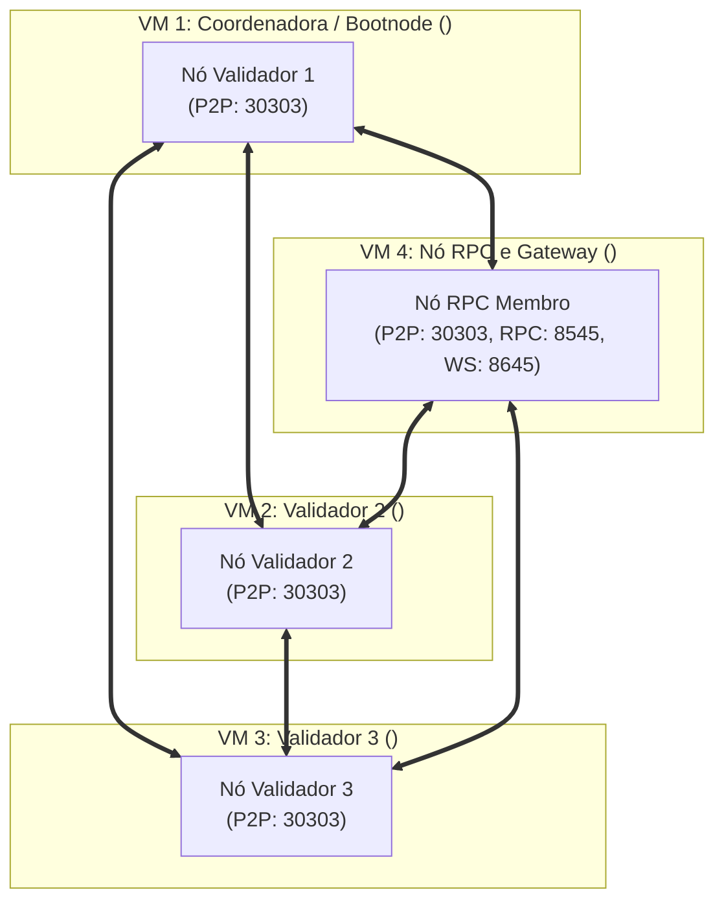

# Arquitetura da Rede Hyperledger Besu Multi-Node (WydenCoin)

Este documento detalha a topologia distribuída em **4 máquinas virtuais (VMs)**, os papéis de cada nó e a matriz de conectividade e segurança da rede privada WydenCoin.

---

## 1. Topologia da Rede (4 VMs)

A rede opera com o algoritmo de consenso **QBFT (Quorum Byzantine Fault Tolerance)** composto por **3 nós validadores** e **1 nó RPC dedicado** para atendimento de APIs, consultas e integrações externas:

---

## 2. Papéis dos Nós

### A. VM 1: Coordenadora / Bootnode (Validador 1)
* **Papel:** ponto de ancoragem para descoberta P2P e primeiro validador do comitê QBFT.
* **Geração Criptográfica:** executa a criação do bloco gênese (`genesis.json`), das chaves dos validadores e das listas de permissão (`permissions_config.toml`).
* **Empacotamento:** produz os pacotes de distribuição (`dist/*.tar.gz`) enviados às demais VMs via `scp`.
* **Portas Expostas:** `30303` TCP/UDP (P2P).

### B. VMs 2 e 3: Nós Validadores (Validadores 2 e 3)
* **Papel:** membros do comitê de validação do consenso QBFT.
* **Execução:** propõem e assinam blocos a cada 2 segundos.
* **Segurança:** o endpoint JSON-RPC externo permanece desabilitado por padrão, protegendo a superfície dos nós validadores.
* **Portas Expostas:** `30303` TCP/UDP (P2P).

### C. VM 4: Nó RPC e Gateway de Aplicação
* **Papel:** ponto de integração para serviços de aplicação, ferramentas de benchmark e coleta de telemetria.
* **Execução:** nó membro sem chave de validação (replica o estado da cadeia e encaminha transações ao comitê).
* **Serviços Associados:** hospeda o [WydenCoin RPC Gateway](../../gateway/GATEWAY_API.md) na porta `8546` e a [stack de monitoramento](../../monitoring/README.md) (Prometheus/Grafana).
* **Portas Principais:**
  * `30303` TCP/UDP (P2P);
  * `8545` TCP (JSON-RPC HTTP restrito ao loopback quando utilizado atrás do RPC Gateway);
  * `8546` TCP (WydenCoin RPC Gateway autenticado via `X-API-KEY`);
  * `8645` TCP (WebSockets para assinatura de eventos on-chain);
  * `9545` TCP (métricas Prometheus em loopback).

---

## 3. Matriz de Firewall e Conectividade

| Porta | Protocolo | Origem | Destino | Finalidade |
| :--- | :--- | :--- | :--- | :--- |
| `30303` | TCP / UDP | Nós da rede Besu | VMs 1, 2, 3 e 4 | Descoberta e sincronização P2P |
| `8546` | TCP | Aplicações clientes / Backend | VM 4 | Acesso REST autenticado ao RPC Gateway |
| `8545` | TCP | Loopback (`127.0.0.1`) | VM 4 | Comunicação local entre Gateway e Besu |
| `8645` | TCP | Indexador / Serviços internos | VM 4 | Escuta de eventos via WebSockets |
| `9545` | TCP | Prometheus local | VM 4 (e validadores, opcional) | Coleta de métricas nativas do Besu |
