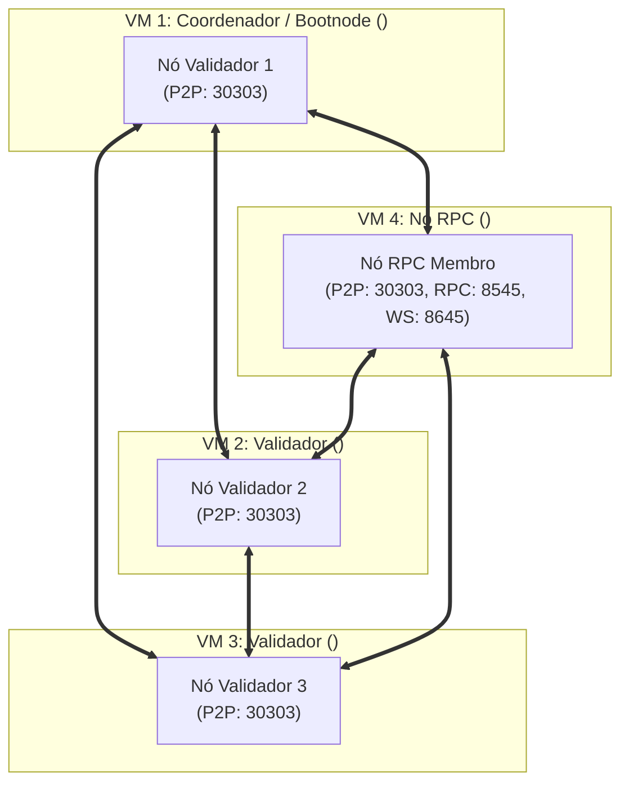

# Laboratório Hyperledger Besu QBFT: Implantação em Múltiplas Máquinas (`lab-multi-node`)

Guia passo a passo para implantação da rede privada Hyperledger Besu (QBFT) em **4 máquinas virtuais (VMs) independentes** utilizando os scripts modulares do diretório `besu/lab-multi-node/`.

### Placeholders Utilizados Neste Guia
* `<node1-ip>`: endereço IP da VM 1 (Coordenadora / Bootnode + Validador 1)
* `<node2-ip>`: endereço IP da VM 2 (Validador 2)
* `<node3-ip>`: endereço IP da VM 3 (Validador 3)
* `<rpc-ip>`: endereço IP da VM 4 (Nó RPC e Gateway)
* `<usuario>`: usuário SSH com permissão de execução nas VMs

---

## 1. Topologia da Rede (4 VMs)

| Máquina | Papel no Consenso | Endereço | Portas | Finalidade |
| :--- | :--- | :--- | :--- | :--- |
| **VM 1** | Coordenador + Validador 1 (Bootnode) | `<node1-ip>` | `30303` (P2P), `8545` (Local) | Descoberta P2P e proposta/assinatura de blocos |
| **VM 2** | Validador 2 | `<node2-ip>` | `30303` (P2P), `8545` (Local) | Assinatura e consenso QBFT |
| **VM 3** | Validador 3 | `<node3-ip>` | `30303` (P2P), `8545` (Local) | Assinatura e consenso QBFT |
| **VM 4** | Nó RPC / Gateway | `<rpc-ip>` | `30303` (P2P), `8545` (RPC), `8645` (WS) | Interface para Gateway REST, consultas e testes |



---

## 2. Procedimento Passo a Passo

### Etapa 1: Pré-requisitos e Firewall (VM 1 a VM 4)

Instale o Docker e o Docker Compose em cada uma das 4 máquinas:

```bash
./besu/scripts/install-docker.sh
```

Configure as regras de firewall (UFW):
* **Todas as 4 VMs (P2P):**
  ```bash
  sudo ufw allow 30303/tcp
  sudo ufw allow 30303/udp
  ```
* **VM 4 (acesso ao Gateway ou RPC em rede autorizada):**
  ```bash
  sudo ufw allow 8546/tcp
  ```

---

### Etapa 2: VM 1 (Coordenadora / Bootnode + Validador 1)

Acesse a VM 1 e navegue até a pasta do laboratório:

```bash
ssh <usuario>@<node1-ip>
cd infra/besu/lab-multi-node
```

#### 2.1. Gerar a Rede e Iniciar o Validador 1

```bash
./02-setup-vm1-coordinator.sh --bootnode-ip <node1-ip>
```

Este script executa:
1. Geração das chaves criptográficas dos 3 validadores via container oficial do Besu.
2. Criação do `genesis.json` (Chain ID `381660001`, intervalo de 2s, taxa zero).
3. Geração do arquivo `permissions_config.toml`.
4. Empacotamento em `dist/` dos arquivos `node2.tar.gz`, `node3.tar.gz` e `rpc-node.tar.gz`.
5. Inicialização do container `besu-node1` e verificação inicial de saúde.

#### 2.2. Transferir os Pacotes para as Demais VMs

```bash
./03-transfer-to-vms.sh \
  --node2-ip <node2-ip> \
  --node3-ip <node3-ip> \
  --rpc-ip <rpc-ip> \
  --user <usuario>
```

O script envia cada pacote `.tar.gz` acompanhado de seu respectivo script de setup (`setup-validator.sh` para VMs 2 e 3; `setup-rpc.sh` para VM 4).

---

### Etapa 3: VM 2 (Validador 2)

```bash
ssh <usuario>@<node2-ip>
./setup-validator.sh node2.tar.gz
```

*(Alternativa manual: `tar -xzf node2.tar.gz && cd node2 && ./run.sh && ./check.sh`.)*

O container `besu-node2` inicia e se conecta ao Bootnode em `<node1-ip>:30303`.

---

### Etapa 4: VM 3 (Validador 3) — Ativação do Quorum QBFT

```bash
ssh <usuario>@<node3-ip>
./setup-validator.sh node3.tar.gz
```

*(Alternativa manual: `tar -xzf node3.tar.gz && cd node3 && ./run.sh && ./check.sh`.)*

> **Quorum QBFT:** com os validadores conectados e atingindo a maioria qualificada (`2F + 1`), as VMs 1, 2 e 3 passam a propor e finalizar blocos continuamente a cada 2 segundos.

---

### Etapa 5: VM 4 (Nó RPC)

```bash
ssh <usuario>@<rpc-ip>
./setup-rpc.sh rpc-node.tar.gz
```

*(Alternativa manual: `tar -xzf rpc-node.tar.gz && cd rpc-node && ./run.sh && ./check.sh`.)*

O nó RPC sincroniza a cadeia com os validadores e disponibiliza as interfaces `8545` (JSON-RPC HTTP), `8645` (WebSockets) e `9545` (métricas Prometheus).

---

### Etapa 6: Diagnóstico e Validação

A partir de uma máquina com acesso à rede do cluster:

```bash
cd infra/besu/lab-multi-node
./04-check-network.sh --rpc-ip <rpc-ip>
```

Ou via `curl` diretamente na VM 4:

```bash
# Bloco atual (deve incrementar a cada 2 segundos)
curl -s -X POST --data '{"jsonrpc":"2.0","method":"eth_blockNumber","params":[],"id":1}' \
  -H "Content-Type: application/json" http://127.0.0.1:8545

# Lista de validadores ativos
curl -s -X POST --data '{"jsonrpc":"2.0","method":"qbft_getValidatorsByBlockNumber","params":["latest"],"id":1}' \
  -H "Content-Type: application/json" http://127.0.0.1:8545
```

---

### Etapa 7: Comandos de Operação Diária

Dentro do diretório extraído de cada nó (`node1/`, `node2/`, `node3/` ou `rpc-node/`):

| Comando | Descrição |
| :--- | :--- |
| `./run.sh` | Inicia o nó via `docker compose up -d` |
| `./check.sh` | Verifica status do container, peers conectados e bloco atual |
| `./stop.sh` | Encerra e remove o container (`docker compose down`) |
| `docker compose logs -f` | Exibe logs do Besu em tempo real |
