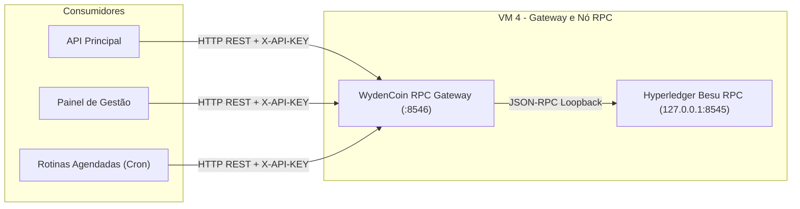

# WydenCoin RPC Gateway API

Camada intermediária (API REST / BFF) responsável por isolar o nó JSON-RPC do Hyperledger Besu, aplicar autenticação por chave de API e abstrair interações Web3 (ABIs, assinatura de transações, limites de gas e codificação `bytes32`) para os demais serviços do ecossistema WydenCoin.

---

## 1. Arquitetura



### Responsabilidades Principais
1. **Isolamento do nó Besu:** mantém a porta JSON-RPC `8545` restrita à interface local (`127.0.0.1`), evitando exposição direta da blockchain à internet.
2. **Autenticação padronizada:** exige `X-API-KEY` ou `Authorization: Bearer <TOKEN>` em todas as rotas operacionais (`/api/v1/*`).
3. **Abstração Web3:** elimina a necessidade de dependências Ethereum (`ethers`, ABIs, gestão manual de nonces) nos consumidores REST.
4. **Custódia centralizada da chave administrativa:** concentra a chave detentora das roles `MINTER_ROLE`, `MANAGER_ROLE` e `CONFIRMER_ROLE` exclusivamente no ambiente do Gateway.
5. **Observabilidade nativa:** expõe métricas Prometheus em `GET /metrics`.

---

## 2. Configuração de Ambiente (`.env`)

Crie o arquivo `.env` a partir de [`.env.example`](.env.example):

```bash
cp .env.example .env
```

| Variável | Obrigatória | Descrição | Exemplo |
| :--- | :---: | :--- | :--- |
| `PORT` | Não | Porta HTTP do servidor Gateway (padrão: `3000`; em produção na VM 4: `8546`) | `8546` |
| `BESU_RPC_URL` | Sim | Endpoint JSON-RPC do nó Hyperledger Besu | `http://127.0.0.1:8545` |
| `API_KEY` | Sim | Chave secreta para autenticação dos clientes | `<SUA_CHAVE_SECRETA>` |
| `ADMIN_PRIVATE_KEY` | Escrita | Chave privada com roles administrativas on-chain (opcional em modo somente leitura) | `0x<CHAVE_PRIVADA>` |
| `WYDENCOIN_ADDRESS` | Sim | Endereço do contrato ERC-20 `WydenCoin` | `0xdB6371a89E3C840a14DE470Dd0247cC7459Fa2A2` |
| `REDEMPTION_MANAGER_ADDRESS` | Sim | Endereço do contrato `RedemptionManager` | `0x6023FF0A8203ea32E737819B301D1672Dd2ECBE0` |

---

## 3. Resumo dos Endpoints

| Método | Rota | Autenticação | Finalidade |
| :--- | :--- | :---: | :--- |
| `GET` | `/health` | Pública | Status do Gateway, rede Besu e endereços dos contratos |
| `GET` | `/metrics` | Interna | Métricas no formato Prometheus (HTTP e runtime Node.js) |
| `GET` | `/api/v1/saldo/:aluno` | `X-API-KEY` | Consulta de saldo válido em WydenCoins (`WC`) |
| `GET` | `/api/v1/saldo/:aluno/lotes` | `X-API-KEY` | Consulta de saldo válido, expirável e lotes com datas de vencimento |
| `GET` | `/api/v1/config/expiracao` | `X-API-KEY` | Consulta do prazo vigente de expiração das moedas |
| `PUT` | `/api/v1/config/expiracao` | `X-API-KEY` | Alteração do prazo de expiração para novas emissões (`DIRECTOR_ROLE`) |
| `POST` | `/api/v1/expiracao/executar` | `X-API-KEY` | Queima on-chain dos lotes vencidos (individual ou lote cron) |
| `POST` | `/api/v1/recompensas/mint` | `X-API-KEY` | Emissão individual de moedas com motivo |
| `POST` | `/api/v1/recompensas/mint-batch` | `X-API-KEY` | Emissão atômica em lote |
| `POST` | `/api/v1/resgates` | `X-API-KEY` | Bloqueio de saldo e emissão de voucher |
| `GET` | `/api/v1/resgates/:id` | `X-API-KEY` | Consulta de dados e status de um voucher |
| `POST` | `/api/v1/resgates/:id/confirmar` | `X-API-KEY` | Confirmação de uso e queima (`burn`) das moedas |
| `POST` | `/api/v1/resgates/:id/cancelar` | `X-API-KEY` | Cancelamento administrativo com estorno |
| `POST` | `/api/v1/resgates/:id/expirar` | `X-API-KEY` | Expiração de voucher vencido com estorno |
| `POST` | `/api/v1/rpc` | `X-API-KEY` | Proxy JSON-RPC autenticado para o nó Besu |

---

## 4. Guias de Integração

Escolha o guia adequado conforme a forma de consumo adotada pela aplicação cliente:

* **Consumo via HTTP/REST puro (qualquer linguagem ou ferramenta HTTP):** consulte [`GUIA_CHAMADAS_JSON.md`](GUIA_CHAMADAS_JSON.md) para payloads completos, exemplos em cURL, JavaScript `fetch`, Python e Dart, além do catálogo de erros HTTP.
* **Consumo via SDK JavaScript/Node.js (`gateway_client.js`):** consulte [`GUIA_CHAMADAS_GATEWAY_CLIENT.md`](GUIA_CHAMADAS_GATEWAY_CLIENT.md) para importação, referência dos métodos da classe `WydencoinGatewayClient` e exemplo de integração em API Express.

---

## 5. Execução Local e Testes

A partir do diretório `gateway/`:

```bash
# Instalar dependências
npm ci

# Executar suíte de testes automatizados
npm test

# Iniciar servidor em desenvolvimento
npm start
```

---

## 6. Deploy em Produção via Docker (VM 4)

Na VM 4, o Gateway é executado com `--network host` para se comunicar em loopback com o Besu (`127.0.0.1:8545`) e expor as métricas para o Prometheus local.

```bash
cd gateway

# Build da imagem
docker build -t wydencoin-gateway:latest .

# Execução do container
docker run -d \
  --name wydencoin-gateway \
  --restart unless-stopped \
  --network host \
  --env-file .env \
  wydencoin-gateway:latest
```

### Regras de Rede Recomendadas
* Liberar entrada TCP apenas na porta configurada em `PORT` (padrão `8546/TCP`) nas regras de firewall / Security List.
* Manter a porta `8545/TCP` (JSON-RPC nativo do Besu) bloqueada para acesso público externo.
