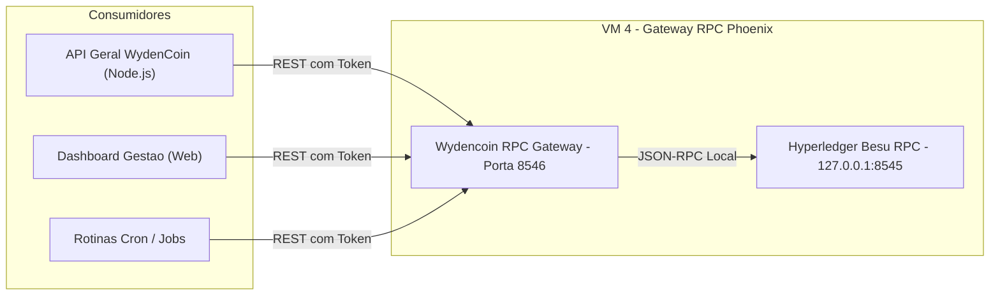

# Wydencoin RPC Gateway API

API Middleware / BFF (Backend For Frontend) para intermediação segura entre as aplicações consumidoras (Backend Geral do WydenCoin, Dashboards e Apps Mobile) e o nó RPC Hyperledger Besu na rede corporativa Oracle Cloud.

---

## 1. Visão Geral e Arquitetura

O **RPC Gateway** isola o nó Besu do acesso público direto, fornecendo uma camada REST semântica, autenticação baseada em API Key/Token, e abstração completa das interações Web3 (ABIs, nonces, estimativas de gas e codificação `bytes32`).



### Vantagens Principais
1. **Blindagem do Besu:** A porta RPC nativa `8545` fica acessível estritamente na interface de loopback (`127.0.0.1`), prevenindo varreduras e ataques de negação de serviço (DoS) externos.
2. **Autenticação Mandatória:** Todas as chamadas operacionais exigem o cabeçalho `X-API-KEY` ou `Authorization: Bearer <TOKEN>`.
3. **Simplicidade para os Desenvolvedores:** Elimina a necessidade de carregar bibliotecas Ethereum (Ethers/Web3.js), compilar ABIs ou calcular parâmetros de rede no backend geral.
4. **Gerenciamento Seguro de Chaves:** A chave privada administrativa (`MINTER_ROLE`, `MANAGER_ROLE`, `CONFIRMER_ROLE`) reside unicamente no Gateway na VM de infraestrutura.

---

## 2. Configurações de Ambiente (`.env`)

| Variável | Descrição | Exemplo Padrão |
| :--- | :--- | :--- |
| `PORT` | Porta HTTP exposta pelo Gateway | `8546` (ou `3000`) |
| `BESU_RPC_URL` | Endpoint local do Besu RPC | `http://127.0.0.1:8545` |
| `API_KEY` | Chave secreta de autenticação da API | `wyden-rpc-sec-9a8f27b4e1` |
| `ADMIN_PRIVATE_KEY`| Chave privada detentora das roles administrativas | `0x8f2a55949038a9610f50fb23b5883af3b4ecb3c3bb792cbcefbd1542c692be63` |
| `WYDENCOIN_ADDRESS`| Endereço do contrato ERC-20 `WydenCoin` | `0xa50a51c09a5c451C52BB714527E1974b686D8e77` |
| `REDEMPTION_MANAGER_ADDRESS`| Endereço do contrato `RedemptionManager` | `0x9a3DBCa554e9f6b9257aAa24010DA8377C57c17e` |

> **Nota de Porta:** O Gateway está publicado na porta **8546** por padrão, pois esta porta já se encontra liberada nas Security Lists da Oracle Cloud (VCN de Phoenix). Caso deseje alterar para a porta `3000`, basta atualizar a variável `PORT` no arquivo `.env` e abrir a porta na OCI.

---

## 3. Especificação dos Endpoints REST

### 3.1. Monitoramento e Saúde

#### `GET /health`
* **Autenticação:** Não requer token (público para monitoramento de uptime).
* **Resposta de Sucesso (`200 OK`):**
  ```json
  {
    "status": "UP",
    "network": {
      "chainId": 381660001,
      "blockNumber": 43210,
      "peers": 2,
      "syncing": false
    },
    "contracts": {
      "wydenCoin": "0xa50a51c09a5c451C52BB714527E1974b686D8e77",
      "redemptionManager": "0x9a3DBCa554e9f6b9257aAa24010DA8377C57c17e"
    },
    "timestamp": "2026-11-14T18:40:00.000Z"
  }
  ```

---

### 3.2. WydenCoin (Token WC)

#### `GET /api/v1/saldo/:aluno`
* **Autenticação:** Obrigatória (`X-API-KEY`).
* **Parâmetros de Rota:** `aluno` (endereço hexadecimal `0x...`).
* **Resposta de Sucesso (`200 OK`):**
  ```json
  {
    "success": true,
    "aluno": "0xfe3b557e8fb62b89f4916b721be55ceb828dbd73",
    "saldo": 200,
    "unidade": "WC"
  }
  ```

#### `POST /api/v1/recompensas/mint`
Emite tokens de bonificação individual associados ao código do critério.
* **Autenticação:** Obrigatória (`X-API-KEY`).
* **Body (`application/json`):**
  ```json
  {
    "aluno": "0x1234567890123456789012345678901234567890",
    "valor": 20,
    "motivo": "SIA_15D"
  }
  ```
* **Resposta de Sucesso (`200 OK`):**
  ```json
  {
    "success": true,
    "txHash": "0xabc123...",
    "blockNumber": 43215,
    "aluno": "0x1234567890123456789012345678901234567890",
    "valor": 20,
    "motivo": "SIA_15D"
  }
  ```

#### `POST /api/v1/recompensas/mint-batch`
Emissão atômica em lote quinzenal para múltiplos alunos em uma única transação on-chain.
* **Autenticação:** Obrigatória (`X-API-KEY`).
* **Body (`application/json`):**
  ```json
  {
    "itens": [
      { "aluno": "0x1111...", "valor": 20, "motivo": "SIA_15D" },
      { "aluno": "0x2222...", "valor": 50, "motivo": "PRES_15D" }
    ]
  }
  ```
* **Resposta de Sucesso (`200 OK`):**
  ```json
  {
    "success": true,
    "totalItens": 2,
    "txHash": "0xdef456...",
    "blockNumber": 43216
  }
  ```

---

### 3.3. RedemptionManager (Gestão de Resgates)

#### `POST /api/v1/resgates`
Retira os tokens da carteira do aluno e os coloca sob custódia do contrato aguardando confirmação presencial.
* **Autenticação:** Obrigatória (`X-API-KEY`).
* **Body (`application/json`):**
  ```json
  {
    "alunoPrivateKey": "0x...",
    "beneficioId": 101,
    "valor": 50,
    "horasValidade": 24
  }
  ```
* **Resposta de Sucesso (`201 Created`):**
  ```json
  {
    "success": true,
    "idResgate": 1,
    "beneficioId": 101,
    "valor": 50,
    "expiraEm": 1794767400,
    "txHash": "0x789abc..."
  }
  ```

#### `GET /api/v1/resgates/:id`
Consulta os dados e status atual de um resgate.
* **Autenticação:** Obrigatória (`X-API-KEY`).
* **Resposta de Sucesso (`200 OK`):**
  ```json
  {
    "success": true,
    "id": 1,
    "aluno": "0x1111...",
    "beneficioId": 101,
    "valor": 50,
    "expiraEm": 1794767400,
    "status": "Resgatado",
    "statusCode": 0
  }
  ```
  *(Status possíveis: `0: Resgatado`, `1: Utilizado`, `2: Cancelado`, `3: Expirado`)*

#### `POST /api/v1/resgates/:id/confirmar`
Validação pelo operador/cantina. Queima permanentemente as moedas custodiadas.
* **Autenticação:** Obrigatória (`X-API-KEY`).
* **Resposta de Sucesso (`200 OK`):**
  ```json
  {
    "success": true,
    "id": 1,
    "status": "Utilizado",
    "txHash": "0x456def...",
    "blockNumber": 43220
  }
  ```

#### `POST /api/v1/resgates/:id/cancelar`
Estorno administrativo manual. Devolve as moedas para a carteira do aluno.
* **Autenticação:** Obrigatória (`X-API-KEY`).
* **Resposta de Sucesso (`200 OK`):**
  ```json
  {
    "success": true,
    "id": 1,
    "status": "Cancelado",
    "txHash": "0x987fed...",
    "blockNumber": 43222
  }
  ```

#### `POST /api/v1/resgates/:id/expirar`
Rotina cron acionada após o vencimento do prazo. Devolve as moedas para o aluno.
* **Autenticação:** Obrigatória (`X-API-KEY`).
* **Resposta de Sucesso (`200 OK`):**
  ```json
  {
    "success": true,
    "id": 1,
    "status": "Expirado",
    "txHash": "0x321fed...",
    "blockNumber": 43225
  }
  ```

---

## 4. Exemplo Prático de Consumo no Backend

Um cliente SDK completo, documentado e autoexecutável com todas as chamadas está disponível no arquivo:
👉 [`gateway_client.js`](gateway_client.js) (Execute com: `node gateway_client.js`).

### Exemplo Rápido (Node.js Nativo com `fetch`):

```javascript
const GATEWAY_URL = "http://129.146.55.236:8546";
const API_KEY = process.env.BLOCKCHAIN_GATEWAY_TOKEN || "wyden-rpc-sec-9a8f27b4e1";

async function creditarRecompensa(alunoAddress, valor, motivo) {
  const response = await fetch(`${GATEWAY_URL}/api/v1/recompensas/mint`, {
    method: "POST",
    headers: {
      "Content-Type": "application/json",
      "X-API-KEY": API_KEY
    },
    body: JSON.stringify({
      aluno: alunoAddress,
      valor: valor,
      motivo: motivo
    })
  });

  const data = await response.json();
  if (!response.ok) {
    throw new Error(data.error || "Falha na comunicação com o Gateway Blockchain");
  }
  
  return data;
}
```

---

## 5. Procedimento de Deploy e Execução na VM 4

O serviço roda como um container Docker integrado na VM 4 (`129.146.55.236`), conectando-se em loopback com o container do Besu.

1. **Build e Start via Docker:**
   ```bash
   docker build -t wydencoin-gateway:latest .
   docker run -d \
     --name wydencoin-gateway \
     --restart unless-stopped \
     --network host \
     --env-file .env \
     wydencoin-gateway:latest
   ```
2. **Porta Exposta no Firewall da VM:**
   * Permitir entrada na porta `3000/TCP` (Security List OCI e `iptables`).
3. **Isolamento da porta 8545:**
   * Garantir que a porta `8545` não seja mais acessível publicamente, mantendo o tráfego restrito ao Gateway na porta `3000`.
