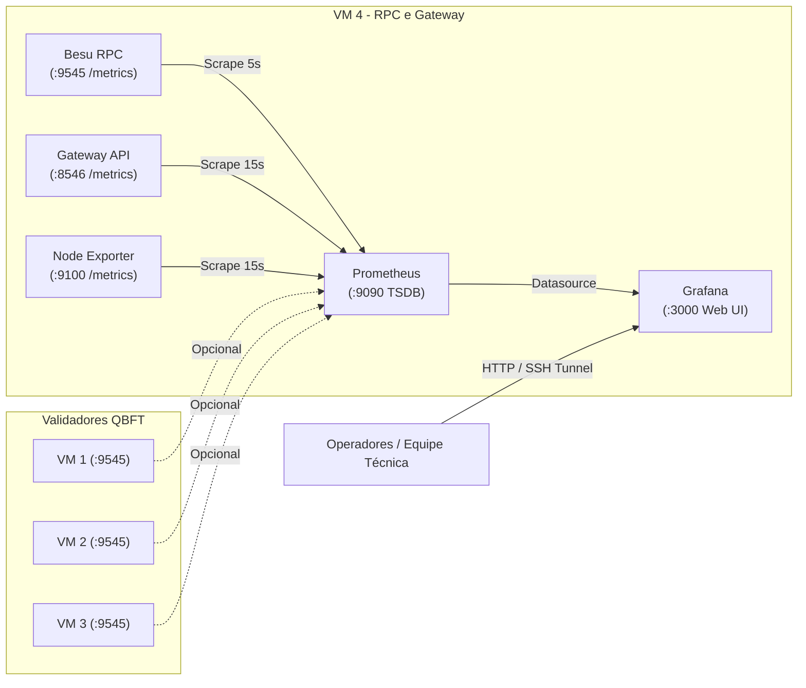

# Stack de Monitoramento e Telemetria (Prometheus + Grafana)

Documentação da stack de observabilidade em tempo real para a rede **Hyperledger Besu (QBFT)** e para a **WydenCoin RPC Gateway API**.

---

## 1. Arquitetura de Observabilidade



---

## 2. Componentes da Stack

| Componente | Imagem Docker | Porta | Escopo | Função |
| :--- | :--- | :---: | :---: | :--- |
| **Prometheus** | `prom/prometheus:v2.54.1` | `9090` | Loopback (`127.0.0.1`) | Coleta de métricas e armazenamento temporal (retenção de 15 dias) |
| **Grafana** | `grafana/grafana-oss:11.2.0` | `3000` | Host (`0.0.0.0`) | Interface web com datasources e dashboards provisionados automaticamente |
| **Node Exporter** | `prom/node-exporter:v1.8.2` | `9100` | Loopback (`127.0.0.1`) | Exposição de métricas do sistema operacional (CPU, memória, disco e rede) |

---

## 3. Dashboards Provisionados

Os dashboards são carregados automaticamente na inicialização do Grafana a partir do diretório `grafana/dashboards/`:

### 3.1. `Hyperledger Besu - WydenCoin Cluster Overview`
* **Bloco Mais Recente (`ethereum_blockchain_height`):** altura atual da cadeia canônica.
* **Peers Conectados (`ethereum_peer_count`):** número de conexões P2P ativas no nó RPC.
* **Fila de Transações (`besu_transaction_pool_transactions`):** transações pendentes no TxPool.
* **Validadores Ativos (QBFT):** contagem de validadores do consenso.
* **Ritmo de Produção de Blocos:** taxa em blocos por minuto (`rate(ethereum_blockchain_height[1m]) * 60`, referência de 30 blocos/min para intervalo de 2s).
* **Volume de Chamadas JSON-RPC:** taxa de requisições recebidas pelo Besu agrupadas por `methodName` (`besu_rpc_request_time_count`).
* **Memória JVM Heap:** uso atual (`jvm_memory_used_bytes`) em relação ao limite configurado (`jvm_memory_max_bytes`).
* **Uso de CPU:** consumo percentual de CPU do processo Besu (`process_cpu_seconds_total`).

### 3.2. `WydenCoin Gateway - API Metrics & Latency`
* **Total de Requisições:** contador acumulado de chamadas HTTP (`gateway_http_requests_total`).
* **Taxa de Erros 5xx:** proporção de falhas internas do servidor.
* **Latência P95 Geral:** percentil 95 do tempo de resposta (`gateway_http_request_duration_seconds_bucket`).
* **Vazão por Rota:** requisições por segundo por endpoint (`/api/v1/saldo/:aluno`, `/api/v1/recompensas/mint`, `/api/v1/resgates`).
* **Latência P95 por Rota:** tempo de resposta detalhado por endpoint.
* **Runtime Node.js:** uso de memória heap e CPU do processo do Gateway.

---

## 4. Implantação e Operação

Todos os comandos abaixo assumem execução a partir do diretório `monitoring/` na raiz do repositório `infra`.

### Execução Local (Ambiente de Testes)

```bash
cd monitoring
./deploy-monitoring.sh --local
```

### Implantação Remota (VM 4)

```bash
cd monitoring
./deploy-monitoring.sh --remote <host-ou-ip-da-vm4>
```

### Acesso ao Grafana

As credenciais iniciais do Grafana são definidas nas variáveis de ambiente do serviço `grafana` em [`docker-compose.yml`](docker-compose.yml) (`GF_SECURITY_ADMIN_USER` e `GF_SECURITY_ADMIN_PASSWORD`). Em produção, recomenda-se alterar a senha no primeiro login ou sobrescrevê-la via ambiente.

* **Acesso direto (requer porta `3000/TCP` liberada no firewall/Security List):**
  `http://<host-da-vm4>:3000`
* **Acesso via túnel SSH (recomendado sem exposição pública da porta `3000`):**
  ```bash
  ssh -L 3000:127.0.0.1:3000 <usuario>@<host-da-vm4>
  ```
  Após abrir o túnel, acesse `http://localhost:3000` no navegador.

---

## 5. Comandos de Manutenção

```bash
# Verificar status dos containers
./deploy-monitoring.sh --status

# Encerrar os containers de monitoramento
./deploy-monitoring.sh --stop
```
