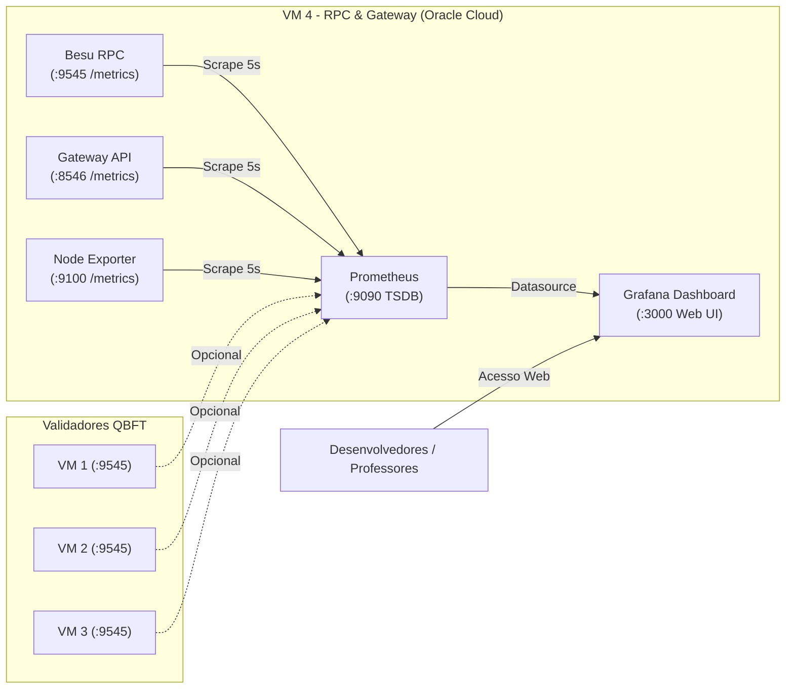

# 📈 WydenCoin Monitoring & Telemetry Stack (Prometheus + Grafana)

Stack completa de observabilidade e telemetria em tempo real para a rede blockchain **Hyperledger Besu (QBFT)** e o **RPC Gateway API**.

---

## 🏛️ 1. Arquitetura de Observabilidade



---

## 📦 2. Componentes da Stack

| Componente | Imagem Docker | Porta | Função |
| :--- | :--- | :---: | :--- |
| **Prometheus** | `prom/prometheus:v2.54.1` | `9090` (Local) | Coletor e banco temporal (*Time Series*) com retenção de 15 dias |
| **Grafana** | `grafana/grafana-oss:11.2.0` | `3000` (Pública) | Interface visual com dashboards pré-carregados |
| **Node Exporter** | `prom/node-exporter:v1.8.2` | `9100` (Local) | Coleta de métricas de SO (CPU, RAM, Disco e Rede da VM) |

---

## 📊 3. Dashboards Pré-Configurados

Os dashboards já vêm pré-instalados via provisionamento automático do Grafana (pasta `grafana/dashboards/`):

### 1️⃣ Dashboard: `Hyperledger Besu - WydenCoin Cluster Overview`
* **Bloco Mais Recente:** Altura do bloco on-chain em tempo real.
* **Peers Conectados:** Quantidade de conexões ativas entre nós da rede.
* **Fila de Transações (TxPool):** Quantidade de transações pendentes de mineração.
* **Validadores QBFT:** Status dos nós validadores em consenso.
* **Ritmo de Mineração (BPM):** Blocos produzidos por minuto (meta: 30 bpm / intervalo de 2s).
* **Volume de Requisições RPC:** Taxa de chamadas JSON-RPC recebidas pelo Besu por método (`eth_blockNumber`, `eth_sendRawTransaction`, etc.).
* **Memória JVM Heap:** Consumo de memória da JVM do Besu vs Heap máxima configurada.
* **Uso de CPU:** Consumo percentual do processo Besu.

### 2️⃣ Dashboard: `WydenCoin Gateway - API Metrics & Latency`
* **Total de Requisições:** Contador de chamadas processadas pela API REST.
* **Taxa de Erros 5xx:** Porcentagem de erros internos do servidor.
* **Latência P95 Geral:** Tempo de resposta em segundos para 95% das chamadas.
* **Vazão por Rota (Req/s):** Throughput específico de rotas como `/api/v1/saldo/:aluno`, `/api/v1/recompensas/mint` e `/api/v1/resgates`.
* **Latência P95 por Rota:** Tempo de resposta detalhado de cada endpoint.
* **Runtime Node.js:** Consumo de memória heap do Gateway e CPU do processo.

---

## 🚀 4. Como Executar

### Opção A: Executar Localmente (Teste)
```bash
cd /home/mikael/Documentos/Codes/infra/monitoring
./deploy-monitoring.sh --local
```
* Acesse: `http://localhost:3000`
* **Usuário:** `admin`
* **Senha:** `wyden2026besu`

### Opção B: Deploy na VM 4 da Oracle Cloud
```bash
cd /home/mikael/Documentos/Codes/infra/monitoring
./deploy-monitoring.sh --remote wydencoin-rpc.duckdns.org
```
* Acesse: `http://wydencoin-rpc.duckdns.org:3000`
* **Usuário:** `admin`
* **Senha:** `wyden2026besu`

> ⚠️ **Nota de Firewall na Oracle Cloud (OCI):**  
> Para acessar o Grafana externamente via porta `3000`, certifique-se de que a porta `3000` TCP de entrada (Ingress Rule) está liberada na **Security List da VCN** na Oracle Cloud. Caso contrário, você pode acessá-lo via túnel SSH:
> ```bash
> ssh -L 3000:127.0.0.1:3000 ubuntu@wydencoin-rpc.duckdns.org
> ```

---

## 🛑 Comandos Úteis

```bash
# Ver status dos containers
./deploy-monitoring.sh --status

# Parar o monitoramento
./deploy-monitoring.sh --stop
```
